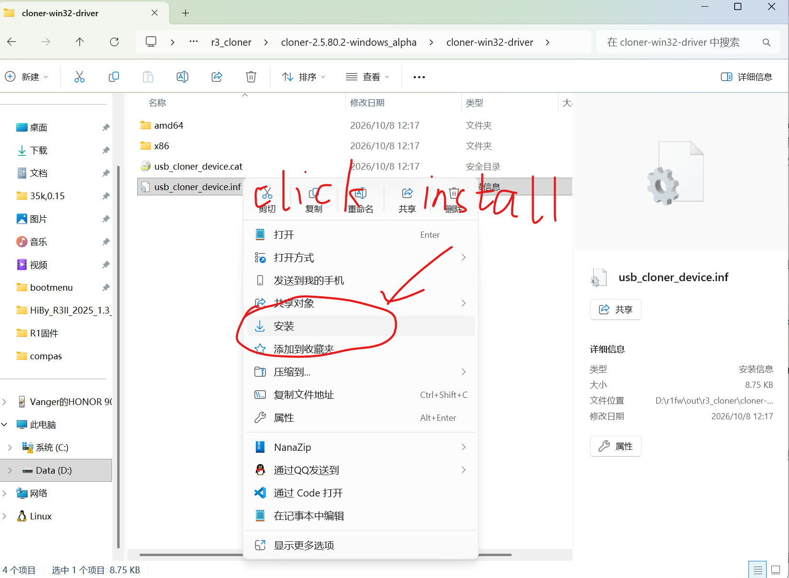
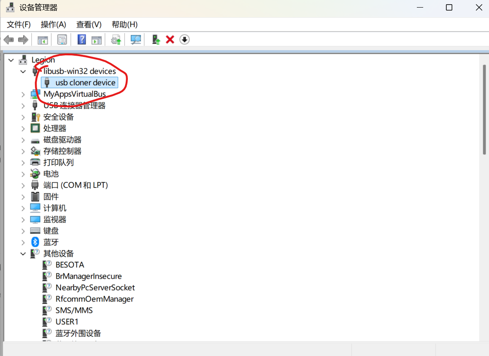
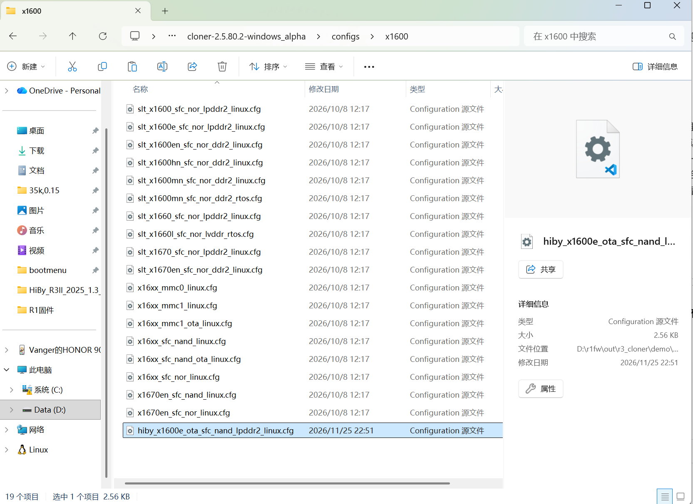
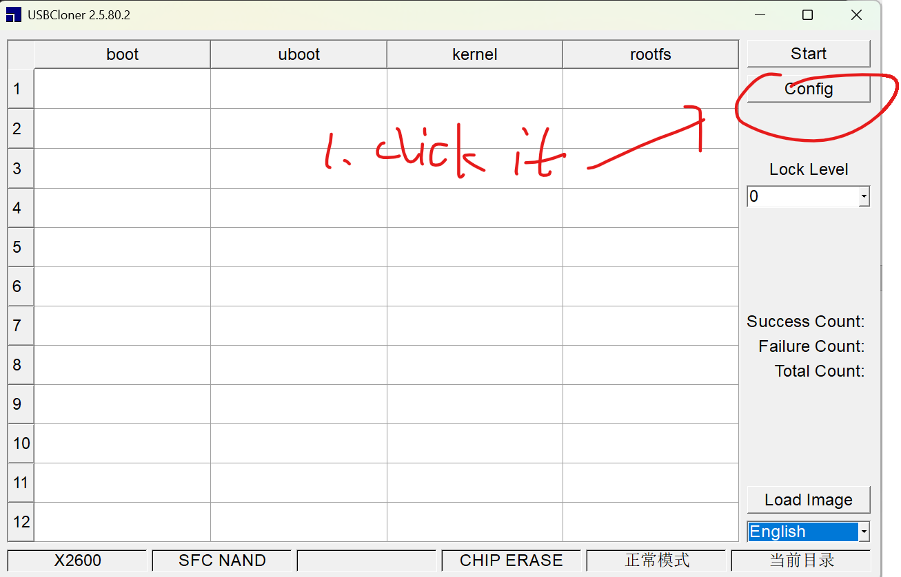
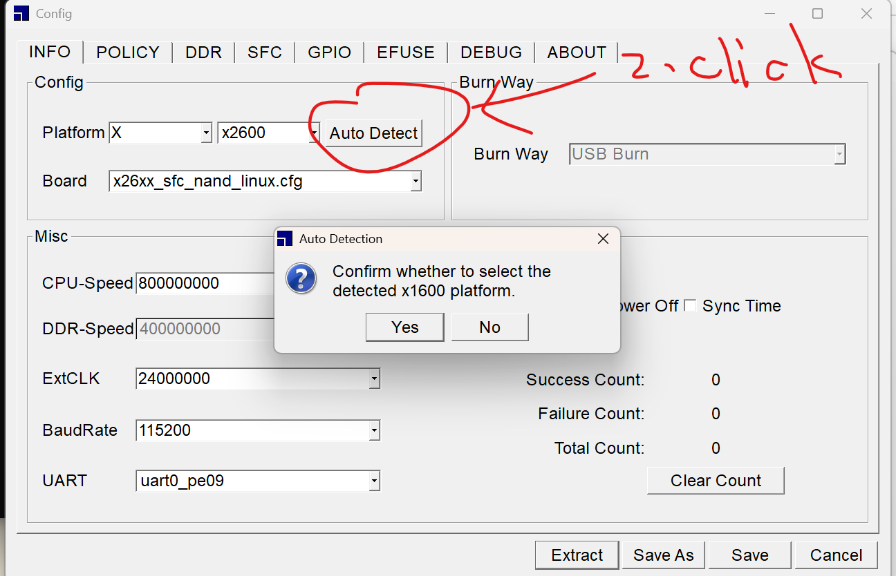

# 海贝 R3II 2025 线刷恢复指南

**简体中文** · [English](#english)

> **本文只针对 HiBy R3II 2025。** 讲的是设备已经进不了任何系统（俗称变砖）时，如何用君正（Ingenic）的 USBCloner 工具通过 USB 把固件写回 flash。如果你只是想切换系统或升级，请回到 [README](../README.md)。

## 什么时候需要线刷

| 情况 | 能否用卡刷 |
| --- | --- |
| 能进任意一个系统，只是想把系统换掉 | ✅ 卡刷即可 |
| 屏幕不亮 / 卡在开机 logo，拔卡也进不了原厂 | ❌ 只能线刷 |
| 能进原厂，但进不了设置菜单 | ❌ 只能线刷 |

原因是结构性的：HiByOS 的卡刷入口在「设置」里，**要先有一个系统在跑**，由它把包写进 flash。系统起不来，就没有任何东西能执行写入。

## 准备工作

| 项目 | 说明 |
| --- | --- |
| Windows 电脑 | Windows 10 / 11 |
| USB-C 数据线 | **必须能传数据**，只能充电的线不行 |
| 线刷工具 | USBCloner `2.5.80.2 windows alpha`（社区包里已附带，也可从君正官网下载） |
| 板级配置 | 本仓库 `docs/r3ii-cloner/` 下的 `hiby_x1600e_ota_sfc_nand_lpddr2_linux.cfg` |
| 固件镜像 | 社区线刷包 `r3ii_cloner.zip`，里面已含 `spl.bin`、`uboot.bin`、`kernel.bin`、`rootfs.squashfs` 等 |

### 下载地址

| 内容 | 地址 |
| --- | --- |
| 社区线刷包（**实测可用**，含工具 + 配置 + 镜像） | `r3ii_cloner.zip` v1.1 —— 链接待补充 |
| 官方整机固件（备用） | HiBy 官网发布页的 `HiBy_R3II_2025_1.3_*.ingenic` |

> ⚠️ **官方 `.ingenic` 配合 2.5.80.2 版工具，实测报 `uboot INIT ERR`**：官方包里带的 spl/uboot 与这个版本的工具有兼容问题。社区包 `r3ii_cloner.zip` 正是为解决它准备的，**优先用它**。

## 操作步骤

### 1. 安装驱动

解压社区包，进入 `cloner-2.5.80.2-windows_alpha\cloner-win32-driver\`，**右键 `usb_cloner_device.inf` → 选择「安装」**。



装好后打开设备管理器，应能在 `libusb-win32 devices` 下看到 **`usb cloner device`**：



> 如果设备管理器里没有这一项：把设备关机后按住「下一曲」插上 USB，再看一次。

### 2. 放好板级配置

把本仓库 `docs/r3ii-cloner/` 下的 `hiby_x1600e_ota_sfc_nand_lpddr2_linux.cfg` 放到：

```
cloner-2.5.80.2-windows_alpha\configs\x1600\
```



工具**只在启动时扫描这个目录**，所以放完要重新打开工具。

### 3. 进入线刷模式

1. 设备**完全关机**（长按电源键，确认屏幕熄灭）
2. **按住「下一曲」不放**
3. 保持按住，把 USB 线插上电脑
4. 松开按键

### 4. 打开工具并配置

运行 `USBCloner.exe`，点击右上角的 **`Config`**：



在弹出的配置窗口里：

1. 点 **`Auto Detect`**
2. 弹窗询问是否选择检测到的 x1600 平台 → 点 **`Yes`**
3. **`Board`** 下拉框选择 `hiby_x1600e_ota_sfc_nand_lpddr2_linux.cfg`
4. 点 **`Save`**



> 如果 `Auto Detect` 认不出平台，说明设备没进线刷模式（没连上），回第 3 步重来。

### 5. 刷写

1. 回到主界面，点 **`Load Image`**，选择社区包里的 `.ingenic`（或官方同名文件）
2. 点 **`Start`**
3. **期间不要拔线、不要锁屏、不要操作电脑**，大约 1–3 分钟
4. 界面显示成功（Success Count 加 1）即可拔线，长按电源键开机

## 常见问题

| 现象 | 原因 | 处理 |
| --- | --- | --- |
| `uboot INIT ERR` | 官方包的 spl/uboot 与工具版本不匹配 | 改用社区包 `r3ii_cloner.zip` |
| `Auto Detect` 无反应 / 认不出平台 | 设备没进线刷模式，或驱动没装 | 重装驱动；确认完全关机后按住「下一曲」再插线 |
| `Board` 里没有 `hiby_...cfg` | 配置放错目录，或工具没重启 | 确认路径 `configs\x1600\`，重启工具 |
| 刷到一半失败 | 线材接触不良、USB 口供电不足 | 换线、换后置 USB 口，重新进入线刷模式再刷 |
| 刷完仍不开机 | 镜像不完整 | 重新下载社区包（核对文件大小） |

## 刷完之后

线刷会把**整个 flash 恢复成原厂单系统状态**：多启动钩子、卡上的系统镜像都不再被使用，开机就是原厂 HiByOS。

想回到多启动：

1. 把 `r3ii.upt` 放到卡根，用「通过 SD 卡升级」刷入（见 [README](../README.md)）
2. 解压对应版本的卡上系统包（`r3ii_mutiboot.zip` 或 `r3ii_cnenhanced.zip`）到卡根
3. 开机按住「播放/暂停」进入菜单选择系统

---

## English

> **This page is about the HiBy R3II 2025 only.** It covers writing the firmware back over USB with Ingenic's USBCloner when the device cannot start any system ("bricked"). To switch systems or update, go back to the [README](../README.md).

### When you need this

| Situation | Card update enough? |
| --- | --- |
| Any system still starts, you only want another one | ✅ yes |
| No display, or stuck on the boot logo even without a card | ❌ cloner only |
| The stock system starts but you cannot reach its settings menu | ❌ cloner only |

The reason is structural: HiByOS performs a card update **from its settings menu**, so it needs a running system to write the image into flash. No system, nothing to do the writing.

### What you need

| Item | Notes |
| --- | --- |
| Windows PC | Windows 10 or 11 |
| USB-C cable | a **data** cable; charge-only cables do not work |
| Flashing tool | USBCloner `2.5.80.2 windows alpha` (bundled in the community package, or from Ingenic) |
| Board config | `docs/r3ii-cloner/hiby_x1600e_ota_sfc_nand_lpddr2_linux.cfg` from this repository |
| Firmware images | the community `r3ii_cloner.zip`, which already contains `spl.bin`, `uboot.bin`, `kernel.bin`, `rootfs.squashfs` and the rest |

### Where to download

| What | Where |
| --- | --- |
| Community package (**verified working**, tool + config + images) | `r3ii_cloner.zip` v1.1 — link to be added |
| HiBy's full firmware (fallback) | `HiBy_R3II_2025_1.3_*.ingenic` from HiBy's release page |

> ⚠️ **HiBy's own `.ingenic` fails on tool 2.5.80.2 with `uboot INIT ERR`**: the spl/uboot it carries does not agree with that version. The community package `r3ii_cloner.zip` exists for this reason — **use it first**.

### Steps

**1. Install the driver.** Unzip the community package, open `cloner-2.5.80.2-windows_alpha\cloner-win32-driver\` and **right-click `usb_cloner_device.inf` → Install**.


Device Manager should then list **`usb cloner device`** under `libusb-win32 devices`:


> If it is missing, power the device off, hold **next track** while plugging the cable in, and look again.

**2. Put the board config in place.** Copy `docs/r3ii-cloner/hiby_x1600e_ota_sfc_nand_lpddr2_linux.cfg` from this repository into

```
cloner-2.5.80.2-windows_alpha\configs\x1600\
```


The tool **scans that folder only at startup**, so reopen it afterwards.

**3. Enter flash mode.** Power the device fully off, hold **next track**, plug the USB cable in while holding, then release.

**4. Configure the tool.** Start `USBCloner.exe` and click **`Config`** in the top right:


In the dialog: press **`Auto Detect`**, answer **`Yes`** to "confirm whether to select the detected x1600 platform", pick `hiby_x1600e_ota_sfc_nand_lpddr2_linux.cfg` in the **`Board`** dropdown, then **`Save`**.


> If `Auto Detect` cannot identify the platform, the device is not in flash mode — repeat step 3.

**5. Flash.** Back in the main window press **`Load Image`**, choose the `.ingenic` from the community package (or HiBy's), then **`Start`**. Do not unplug, lock the screen or touch anything for the 1–3 minutes it takes; unplug and power on once it reports success (Success Count increases).

### Troubleshooting

| Symptom | Cause | Fix |
| --- | --- | --- |
| `uboot INIT ERR` | the spl/uboot in the package does not match the tool version | use the community `r3ii_cloner.zip` |
| `Auto Detect` does nothing / cannot identify the platform | the device is not in flash mode, or the driver is missing | reinstall the driver; power off fully, hold **next track**, then plug in |
| `hiby_...cfg` missing from the `Board` list | wrong folder, or the tool was not restarted | check `configs\x1600\`, reopen the tool |
| Fails part way through | bad cable or weak USB port | change the cable/port, enter flash mode again and retry |
| Still will not boot | incomplete image | download the community package again (check the size) |

### After flashing

The flash is the stock single-system layout again: the multi-boot hook and the card images are unused, and the device boots HiByOS.

To return to multi-boot:

1. put `r3ii.upt` in the card root and flash it with **Settings → Firmware update → via SD card** (see the [README](../README.md));
2. unzip the card archive for the variant you want (`r3ii_mutiboot.zip` or `r3ii_cnenhanced.zip`) into the card root;
3. hold **PLAY/PAUSE** while powering on to reach the boot menu.
