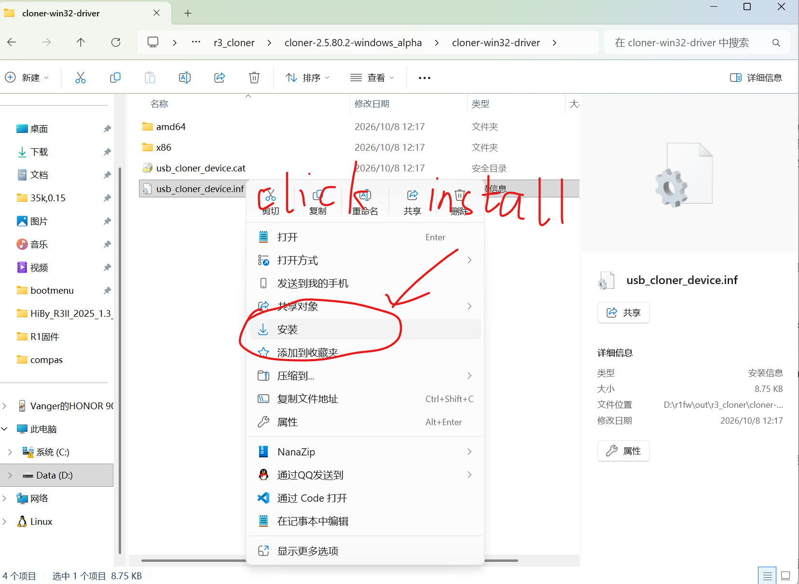
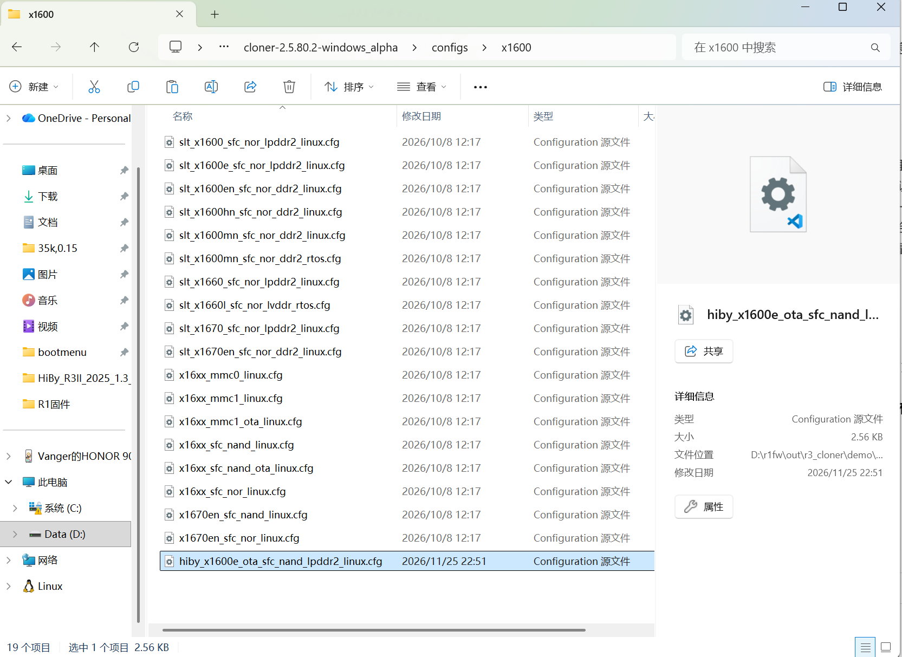
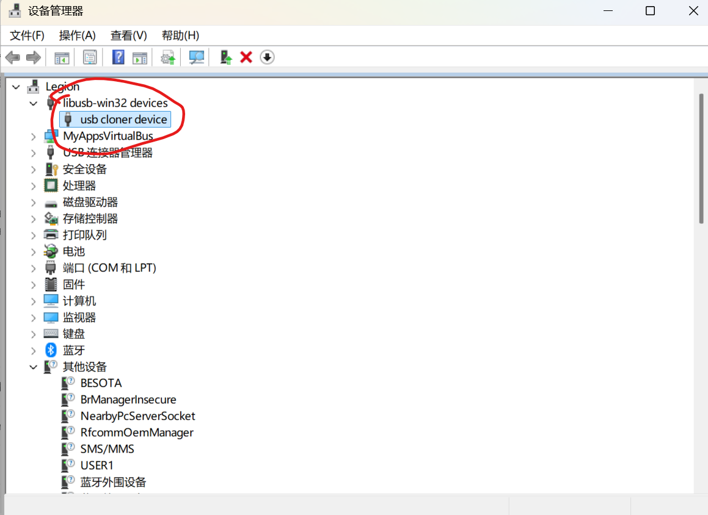
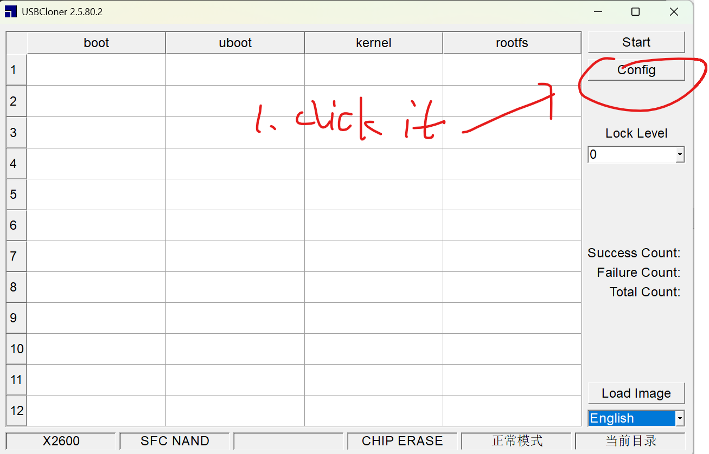
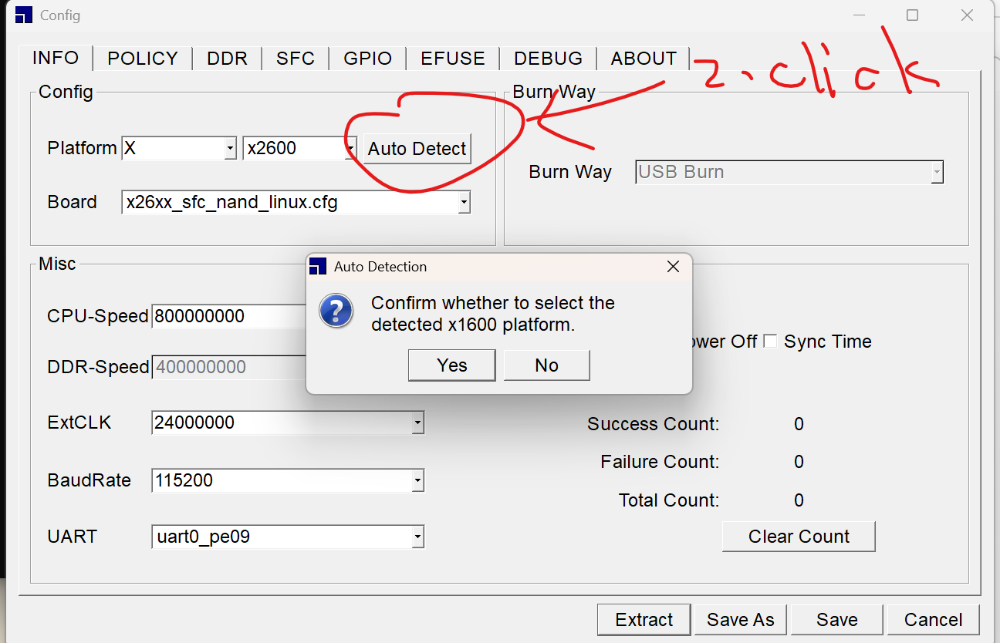
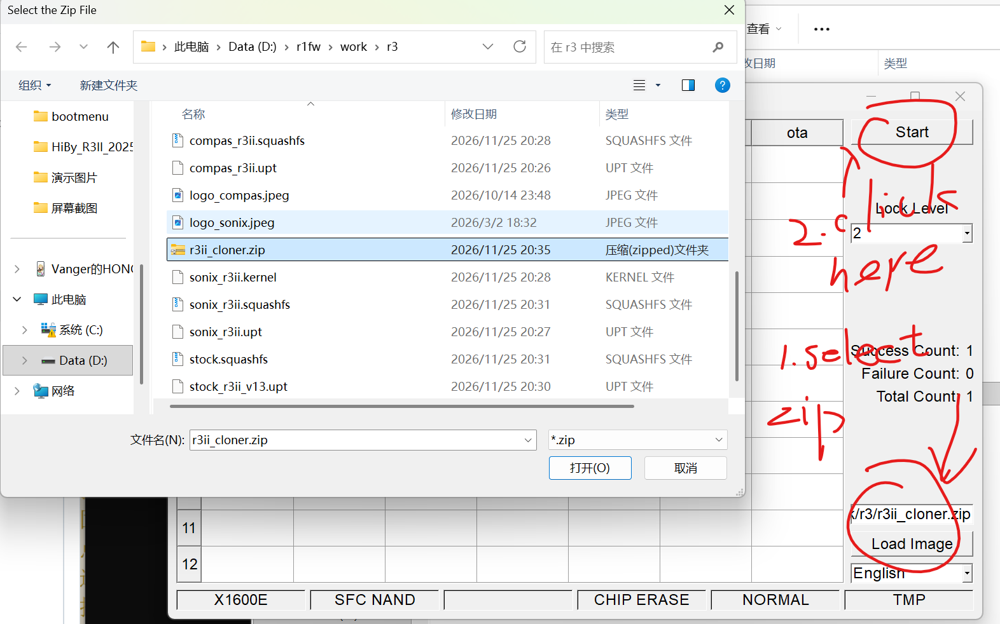

# 海贝 R3II 2025 线刷恢复指南

**简体中文** · [English](#english)

> **本文只针对 HiBy R3II 2025。** 讲的是设备已经进不了任何系统（俗称变砖）时，如何用君正（Ingenic）的 USBCloner 通过 USB 把固件写回 flash。如果你只是想切换系统或升级，请回到 [README](../README.md)。

## 什么时候需要线刷

| 情况 | 能否用卡刷 |
| --- | --- |
| 能进任意一个系统，只是想把系统换掉 | ✅ 卡刷即可 |
| 屏幕不亮 / 卡在开机 logo，拔卡也进不了原厂 | ❌ 只能线刷 |
| 能进原厂，但进不了设置菜单 | ❌ 只能线刷 |

原因是结构性的：HiByOS 的卡刷入口在「设置」里，**要先有一个系统在跑**，由它把包写进 flash。系统起不来，就没有任何东西能执行写入。

## 下载

| 内容 | 地址 |
| --- | --- |
| **社区整包（实测可用）** | [`HiBy_R3II_v1.1_cloner_2.5.80.2.zip`](https://github.com/hiby-modding/hiby_os_crack/blob/main/firmwares/r3ii_2025/recovery_cloner/HiBy_R3II_v1.1_cloner_2.5.80.2.zip)：含 USBCloner 2.5.80.2、可用 spl/uboot、完整镜像与配置 |
| USBCloner（单独下载） | [Ingenic-community/Cloner releases](https://github.com/Ingenic-community/Cloner/releases) |
| 板级配置 | 本仓库的 [`hiby_x1600e_ota_sfc_nand_lpddr2_linux.cfg`](r3ii-cloner/hiby_x1600e_ota_sfc_nand_lpddr2_linux.cfg) |

> ⚠️ **官方 `HiBy_R3II_2025_1.3_*.ingenic` 配合 2.5.80.2 版工具，实测报 `uboot INIT ERR`**：官方包里带的 spl/uboot 与该版本工具不兼容。上面那个社区整包就是为此准备的，**优先用它**。

## 操作步骤

### 1. 先安装驱动

解压社区整包，进入 `cloner-2.5.80.2-windows_alpha\cloner-win32-driver\`，**右键 `usb_cloner_device.inf` → 选择「安装」**。



> 此时设备管理器里**还看不到**任何设备，这是正常的——驱动装好只是前提，设备要进入烧录模式并连上 USB 才会出现。

### 2. 放好板级配置

把 [`hiby_x1600e_ota_sfc_nand_lpddr2_linux.cfg`](r3ii-cloner/hiby_x1600e_ota_sfc_nand_lpddr2_linux.cfg) 放到：

```
cloner-2.5.80.2-windows_alpha\configs\x1600\
```



工具**只在启动时扫描这个目录**，所以放完要重新打开工具。

### 3. 进入烧录模式并连接

1. 设备**完全关机**（长按电源键，确认屏幕熄灭）
2. **按住「下一曲」不放，再按一下电源键**，让设备进入烧录模式
3. 保持连接，把 USB 线插上电脑

**只有在驱动已安装、且设备处于烧录模式并连上 USB 之后**，设备管理器才会在 `libusb-win32 devices` 下显示 **`usb cloner device`**：



> 看不到这一项时按顺序排查：驱动是否装过 → 是否真的进了烧录模式（屏幕应保持黑屏，不出现 logo）→ 换一根**能传数据**的线。

### 4. 打开工具并配置

运行 `USBCloner.exe`，点击右上角的 **`Config`**：



在弹出的配置窗口里：

1. 点 **`Auto Detect`**
2. 弹窗询问是否选择检测到的 x1600 平台 → 点 **`Yes`**
3. **`Board`** 下拉框选择 `hiby_x1600e_ota_sfc_nand_lpddr2_linux.cfg`
4. 点 **`Save`**



> 如果 `Auto Detect` 认不出平台，说明设备没连上或不在烧录模式，回第 3 步重来。

### 5. 选择镜像并开始刷写

1. 回到主界面，点 **`Load Image`**
2. 在弹出的文件框里，**直接选中社区整包 `HiBy_R3II_v1.1_cloner_2.5.80.2.zip` 本身**
   —— 不需要解压，工具会自己从 zip 里取 spl、uboot、kernel、rootfs
3. 确认主界面右下角显示的是这个 zip 的路径，点 **`Start`**
4. **期间不要拔线、不要锁屏、不要操作电脑**，大约 1–3 分钟
5. 界面显示成功（Success Count 加 1）即可拔线，长按电源键开机



## 常见问题

| 现象 | 原因 | 处理 |
| --- | --- | --- |
| `uboot INIT ERR` | 官方包的 spl/uboot 与工具版本不匹配 | 改用社区整包 |
| 设备管理器看不到 `usb cloner device` | 驱动未装 / 没进烧录模式 / 线只能充电 | 按第 3 步的顺序排查 |
| `Auto Detect` 无反应 | 设备未连接 | 重新进入烧录模式并插线 |
| `Board` 里没有 `hiby_...cfg` | 配置放错目录，或工具没重启 | 确认路径 `configs\x1600\`，重启工具 |
| 刷到一半失败 | 线材接触不良、USB 口供电不足 | 换线、换后置 USB 口，重新刷 |
| 刷完仍不开机 | 镜像不完整 | 重新下载社区整包（核对文件大小） |

## 刷完之后

线刷会把**整个 flash 恢复成原厂单系统状态**：多启动钩子、卡上的系统镜像都不再被使用，开机就是原厂 HiByOS。

想回到多启动：

1. 把 `r3ii_2025.upt` 放到卡根，用「通过 SD 卡升级」刷入（见 [README](../README.md)）
2. 解压对应版本的卡上系统包（`r3ii_mutiboot.zip` 或 `r3ii_cnenhanced.zip`）到卡根
3. 开机按住「播放/暂停」进入菜单选择系统

---

## English

> **This page is about the HiBy R3II 2025 only.** It covers writing the firmware back over USB with Ingenic's USBCloner when the device cannot start any system ("bricked"). To switch systems or update, go back to the [README](../README.md).

### When you need this

| Situation | Card update enough? |
| --- | --- |
| Any system still starts, you only want another one | ✅ yes |
| No display, or stuck on the boot logo even without a card | ❌ cloner only |
| The stock system starts but you cannot reach its settings menu | ❌ cloner only |

The reason is structural: HiByOS performs a card update **from its settings menu**, so it needs a running system to write the image into flash. No system, nothing to do the writing.

### Downloads

| What | Where |
| --- | --- |
| **Community package (verified working)** | [`HiBy_R3II_v1.1_cloner_2.5.80.2.zip`](https://github.com/hiby-modding/hiby_os_crack/blob/main/firmwares/r3ii_2025/recovery_cloner/HiBy_R3II_v1.1_cloner_2.5.80.2.zip) — USBCloner 2.5.80.2, working spl/uboot, full images and config |
| USBCloner on its own | [Ingenic-community/Cloner releases](https://github.com/Ingenic-community/Cloner/releases) |
| Board config | this repository's [`hiby_x1600e_ota_sfc_nand_lpddr2_linux.cfg`](r3ii-cloner/hiby_x1600e_ota_sfc_nand_lpddr2_linux.cfg) |

> ⚠️ **HiBy's `HiBy_R3II_2025_1.3_*.ingenic` fails on tool 2.5.80.2 with `uboot INIT ERR`**: the spl/uboot it carries does not agree with that version. The community package above exists for this reason — **use it first**.

### Steps

**1. Install the driver first.** Unzip the community package, open `cloner-2.5.80.2-windows_alpha\cloner-win32-driver\` and **right-click `usb_cloner_device.inf` → Install**.


> Device Manager shows **nothing** yet — that is expected. The driver alone is not enough; the device has to be in burn mode and plugged in.

**2. Put the board config in place.** Copy [`hiby_x1600e_ota_sfc_nand_lpddr2_linux.cfg`](r3ii-cloner/hiby_x1600e_ota_sfc_nand_lpddr2_linux.cfg) into

```
cloner-2.5.80.2-windows_alpha\configs\x1600\
```


The tool **scans that folder only at startup**, so reopen it afterwards.

**3. Enter burn mode and connect.** Power the device fully off, **hold next track and press power** to put it into burn mode, then plug the USB cable in.

Only with the driver installed, the device in burn mode and the cable connected does Device Manager list **`usb cloner device`** under `libusb-win32 devices`:


> If it stays missing: was the driver installed → is the device really in burn mode (the screen stays black, no logo) → try a **data** cable.

**4. Configure the tool.** Start `USBCloner.exe` and click **`Config`** in the top right:


Press **`Auto Detect`**, answer **`Yes`** to "confirm whether to select the detected x1600 platform", pick `hiby_x1600e_ota_sfc_nand_lpddr2_linux.cfg` in the **`Board`** dropdown, then **`Save`**.


> If `Auto Detect` cannot identify the platform, the device is not connected or not in burn mode — repeat step 3.

**5. Choose the image and flash.** Back in the main window press **`Load Image`**, then select the community archive **`HiBy_R3II_v1.1_cloner_2.5.80.2.zip` itself** — do not unzip it; the tool reads spl, uboot, kernel and rootfs straight out of the zip. Check that the path shown at the bottom right is that zip, press **`Start`**, and do not unplug, lock the screen or touch anything for the 1–3 minutes it takes. Unplug and power on once it reports success (Success Count increases).


### Troubleshooting

| Symptom | Cause | Fix |
| --- | --- | --- |
| `uboot INIT ERR` | the spl/uboot in the package does not match the tool version | use the community package |
| `usb cloner device` never appears | driver missing / not in burn mode / charge-only cable | walk through step 3 again |
| `Auto Detect` does nothing | device not connected | re-enter burn mode and plug in |
| `hiby_...cfg` missing from the `Board` list | wrong folder, or the tool was not restarted | check `configs\x1600\`, reopen the tool |
| Fails part way through | bad cable or weak USB port | change the cable/port and retry |
| Still will not boot | incomplete image | download the community package again (check the size) |

### After flashing

The flash is the stock single-system layout again: the multi-boot hook and the card images are unused, and the device boots HiByOS.

To return to multi-boot:

1. put `r3ii_2025.upt` in the card root and flash it with **Settings → Firmware update → via SD card** (see the [README](../README.md));
2. unzip the card archive for the variant you want (`r3ii_mutiboot.zip` or `r3ii_cnenhanced.zip`) into the card root;
3. hold **PLAY/PAUSE** while powering on to reach the boot menu.
